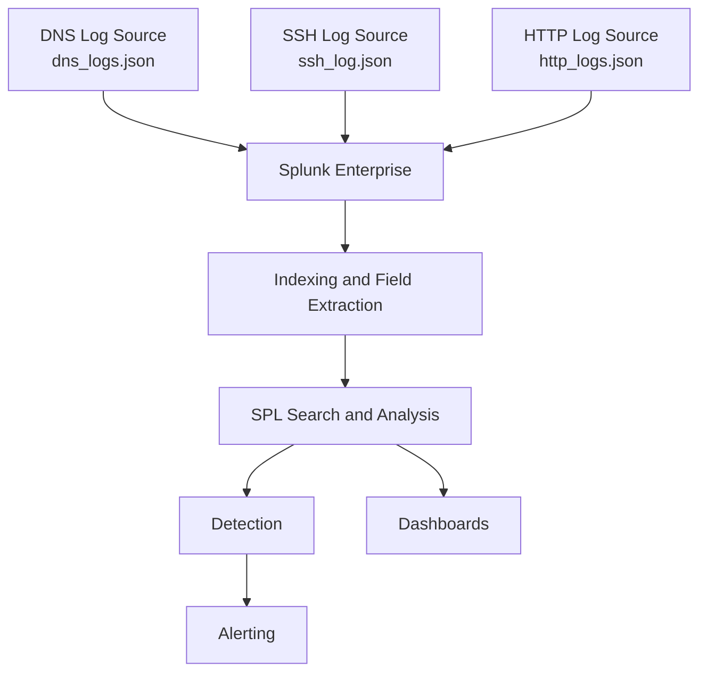
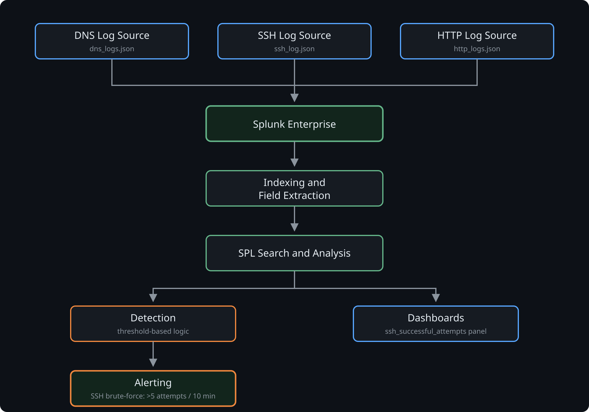

# Splunk SIEM Homelab – Multi-Source Log Analysis

## Overview

This project demonstrates practical SOC monitoring and investigation using **Splunk Enterprise**. Three log sources — DNS, SSH, and HTTP — were ingested into a single Splunk index, and each was investigated with purpose-built SPL queries covering the core skills of a SOC analyst workflow:

- **Multi-source log ingestion** — DNS, SSH, and HTTP JSON logs loaded into the `homelab` index.
- **DNS, SSH and HTTP analysis** — traffic baselining, authentication monitoring, and web-attack triage.
- **SPL query development** — aggregation, ranking, filtering, and time-series analysis with `stats`, `sort`, `head`, `table`, `IN`, `where`, and `timechart`.
- **Security event investigation** — failed logins, brute-force patterns, unauthenticated probing, scripted user agents, sensitive-URI reconnaissance, and oversized transfers.
- **Threshold-based alert configuration** — an SSH brute-force alert design (>5 login attempts within 10 minutes).
- **Dashboard creation** — a saved dashboard panel for successful SSH logins (`ssh_successful_attempts`).

All results and statistics in this repository come directly from screenshots captured during the work; nothing is estimated or invented.

## Objectives

1. Ingest heterogeneous JSON log sources (DNS, SSH, HTTP) into Splunk Enterprise and validate field extraction.
2. Develop SPL queries that answer concrete security questions for each log source.
3. Establish behavioral baselines (query volumes, login patterns, transfer sizes) that make anomalies recognizable.
4. Detect and attribute suspicious activity: brute-force authentication, unauthenticated probing, scripted tooling, sensitive-path reconnaissance, and large data transfers.
5. Design a threshold-based alert for SSH brute force and visualize activity with Splunk dashboards.

## Technology Stack

| Technology | Role |
|---|---|
| Splunk Enterprise | SIEM platform — log ingestion, indexing, search |
| Search Processing Language (SPL) | Query language for all investigations |
| DNS, SSH and HTTP JSON logs | Data sources ingested into the `homelab` index |
| Splunk Search & Reporting | Investigation interface used for all searches |
| Splunk dashboards and visualizations | Column chart and saved dashboard panel |

## Architecture

```
DNS / SSH / HTTP Log Sources
        |
        v
Splunk Enterprise
        |
        v
Indexing and Field Extraction
        |
        v
SPL Search and Analysis
        |
        +-------------------+
        |                   |
        v                   v
    Detection             Dashboards
        |
        v
    Alerting
```



A rendered version is available here: 

## Investigation Scenarios

### 1. DNS Log Analysis

- **Objective:** baseline DNS activity — most queried domains, busiest source hosts, and record-type distribution.
- **What was analyzed:** 1,200–2,400 DNS events; top domains (google.com, printer.local, example.com...), 12 source hosts, and the A/AAAA/CNAME/PTR mix.
- **SPL techniques:** `stats count by`, `sort - count`, field filtering by `source` and `sourcetype`.
- **Security relevance:** DNS is a prime C2 and exfiltration channel; frequency, volume, and query-type baselines are what make tunneling or DGA activity recognizable.
- **Details:** [docs/DNS-Log-Analysis.md](docs/DNS-Log-Analysis.md)

### 2. SSH Log Analysis

- **Objective:** monitor SSH authentication — validate ingestion, profile failed logins, detect brute-force patterns, track successful logins, and hunt unauthenticated probing.
- **What was analyzed:** 1,200 SSH events across four event types (305 failed, 303 multiple-failed, 306 successful, 286 unauthenticated connections); per-source rankings and a time-based view.
- **SPL techniques:** `stats count by` (event type, source IP, source/destination pairs), `where` threshold filtering, `timechart`.
- **Security relevance:** SSH brute force is a leading initial-access and lateral-movement vector; failure-rate thresholds and failure-then-success correlation are the core detections.
- **Details:** [docs/SSH-Log-Analysis.md](docs/SSH-Log-Analysis.md)

### 3. HTTP Log Analysis

- **Objective:** triage web traffic — top talkers, server errors, scripted user agents, oversized transfers, and sensitive-URI access.
- **What was analyzed:** 3,000 HTTP events; 285 5xx errors, 296 requests from scripted tooling (sqlmap, curl, python-requests, botnet-checker), 323 transfers over 500 KB, and 98 requests to `/admin`, `/shell.php`, `/etc/passwd`.
- **SPL techniques:** numeric field filters (`status_code`, `resp_body_len`), `IN` operator, `table`, `head`, aggregation by URI and source.
- **Security relevance:** web logs expose the full attack lifecycle — reconnaissance (`/admin`, `/etc/passwd`), exploitation tooling (sqlmap), and exfiltration (large responses).
- **Details:** [docs/HTTP-Log-Analysis.md](docs/HTTP-Log-Analysis.md)

## Detection Engineering

| Use Case | Detection Logic | Security Relevance | Status |
|---|---|---|---|
| SSH brute-force | More than 5 login attempts within 10 minutes | Potential password guessing | **Alert documented as configured** during the project; the detection search is evidenced by screenshot, the saved alert object is not — to be verified in the Splunk instance |
| Suspicious HTTP user agents | Identify known scripted-tool user agents (sqlmap, curl, python-requests, botnet-checker) | Potential automated activity | Investigative search (evidenced) |
| Sensitive URI access | Investigate requests to sensitive paths (`/admin`, `/shell.php`, `/etc/passwd`) | Potential web reconnaissance | Investigative search (evidenced) |
| Large file transfers | Response body exceeding 500 KB | Investigate unusual transfers | Investigative search (evidenced) |
| DNS monitoring | Analyze query frequency and source IPs | Identify unusual DNS activity | Investigative searches (evidenced) |
| SSH repeated failures | Failure count per source/target pair above filter (`where count > 3`) | Brute-force behavioral pattern | Investigative search (evidenced) |
| Unauthenticated SSH connections | Count connections with no authentication attempt | Port scanning / SSH probing | Investigative search (evidenced) |

The SSH threshold (>5 attempts / 10 minutes) is the only detection documented as an *alert configuration*; everything else in this repository consists of investigative searches. No detection in this project is claimed to have produced a confirmed security incident — the findings are investigation leads.

## Skills Demonstrated

- SIEM log ingestion and analysis
- SPL query development
- Authentication monitoring
- Network traffic investigation
- Detection engineering
- Threshold-based alerting
- Dashboard development
- Security event investigation

## Repository Structure

```
splunk-siem-homelab/
├── README.md            <- this file: project overview and navigation
├── docs/                <- detailed investigation write-ups (one per log source)
├── screenshots/         <- Splunk search evidence, organized by log source
│   ├── architecture.png
│   ├── dns/
│   ├── ssh/
│   └── http/
└── queries/             <- all SPL queries, commented, one file per log source
```

## AI Usage and Critical Thinking

AI assistance was used in this project for documentation support — organizing write-ups, explaining SPL syntax, and reviewing structure. All detection logic, queries, and security conclusions are based on searches actually executed in Splunk by the project author, with results captured in screenshots.

AI can assist with SPL syntax research, troubleshooting, documentation, and understanding log fields — but detection logic must be understood, reviewed, and validated by the analyst. No threat in this project was "detected by AI": every query was run manually in Splunk Search & Reporting, and every conclusion traces back to observed evidence.

## Disclaimer

This is a controlled homelab project using sample log data in a private lab environment (RFC 1918 address space: `10.0.0.0/8`, `192.168.1.0/24`). Indicators such as sqlmap traffic, `/etc/passwd` requests, or repeated SSH failures are investigation leads observed in the data — they do not automatically establish malicious activity, and no confirmed incident is claimed in this repository.

---

Start with the detailed investigations: [DNS](docs/DNS-Log-Analysis.md) · [SSH](docs/SSH-Log-Analysis.md) · [HTTP](docs/HTTP-Log-Analysis.md)
