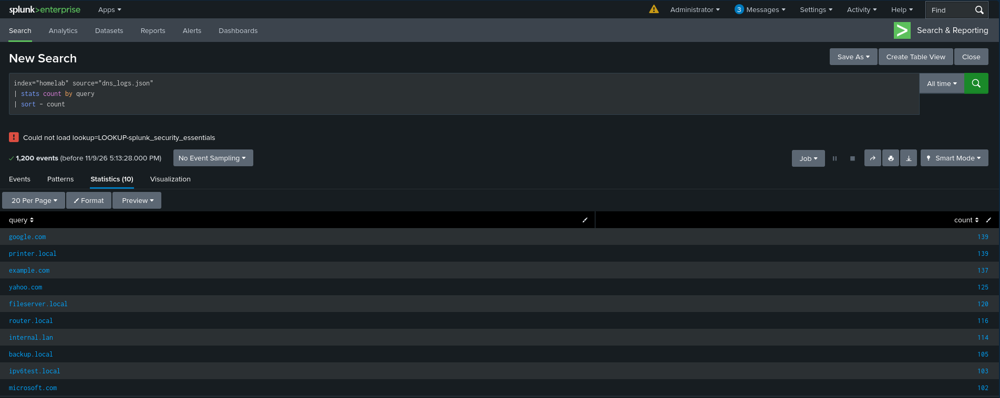
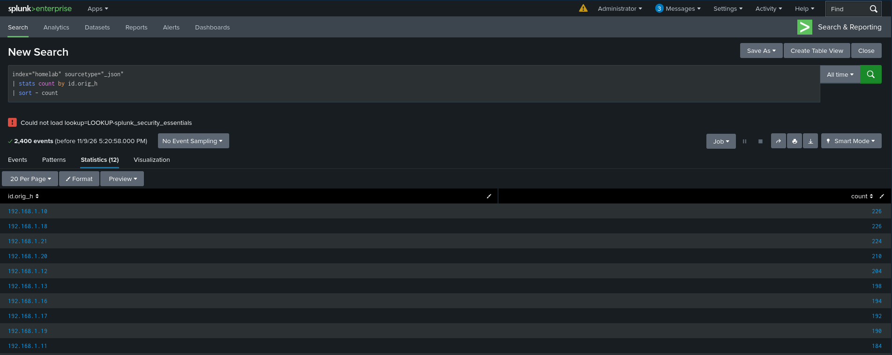
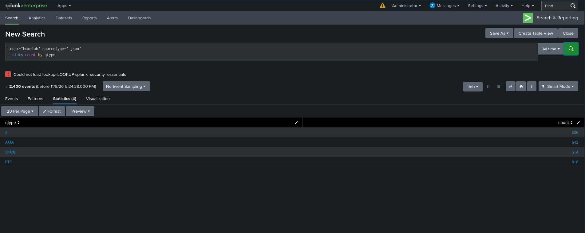

# DNS Log Analysis with Splunk

## 1. Investigation Overview

This investigation analyzes DNS traffic ingested into Splunk Enterprise to establish a baseline of normal name-resolution activity in the homelab environment. The work covers three questions: which domains are queried most frequently, which source hosts generate the most DNS traffic, and how queries are distributed across DNS record types.

DNS is one of the most common channels for command-and-control (C2) communication, data exfiltration, and malware rendezvous, because it is almost never blocked outright. Establishing what "normal" looks like is the prerequisite for spotting deviations such as beaconing to rare domains, unusually high query volumes from a single host, or suspicious record types (e.g., TXT/NULL queries used for tunneling).

## 2. Log Source and Data

| Property | Value |
|---|---|
| Index | `homelab` |
| Source (Task 1) | `dns_logs.json` |
| Sourcetype (Tasks 2–3) | `_json` |
| Log format | JSON |
| Key fields | `query` (queried domain), `id.orig_h` (client source IP), `qtype` (DNS record type) |

> **Data-quality note:** Task 1 filters on `source="dns_logs.json"` while Tasks 2 and 3 filter on `sourcetype="_json"`. Both resolve within the `homelab` index, but the filtering approach is inconsistent across tasks. Standardizing on a dedicated sourcetype (e.g., `dns_logs`) would be a worthwhile improvement — see the optional section in [`queries/dns-queries.spl`](../queries/dns-queries.spl).

> **Environment note:** During these searches Splunk displayed the warning `Could not load lookup=LOOKUP-splunk_security_essentials`. This is a missing lookup definition from the Splunk Security Essentials app and does not affect the search results shown below.

## 3. Investigation Tasks

### Task 1: Identify the most frequently queried domain names

**Objective:** Establish which domains receive the highest query volume, providing a baseline of expected destinations and highlighting any domain that stands out.

**SPL Query:**

```spl
index="homelab" source="dns_logs.json"
| stats count by query
| sort - count
```

**Query Explanation:**

| Command | Purpose |
|---|---|
| `index="homelab" source="dns_logs.json"` | Restricts the search to DNS events in the homelab index, identified by their source file. |
| `stats count by query` | Groups all events by the queried domain name (`query`) and counts events per domain. |
| `sort - count` | Sorts results in descending order so the most queried domains appear first. |

**Analysis:**

The search returned **1,200 events**. The most queried domains were evenly distributed:

| query | count |
|---|---|
| google.com | 139 |
| printer.local | 139 |
| example.com | 137 |
| yahoo.com | 125 |
| fileserver.local | 120 |
| router.local | 116 |
| internal.lan | 114 |
| backup.local | 105 |
| ipv6test.local | 103 |
| microsoft.com | 102 |

The distribution is healthy and expected for a lab environment: a mix of well-known public domains (google.com, yahoo.com, microsoft.com) and internal infrastructure names (printer.local, fileserver.local, router.local, internal.lan, backup.local). No single domain dominates the traffic and no high-entropy or lookalike domains appear at the top.

**SOC Analyst Perspective:**

Frequency analysis is the starting point for DNS threat hunting. In a real investigation, the next steps would be to look at the *bottom* of this list rather than the top — rare domains queried only once or twice, random-looking hostnames (possible DGA malware), or lookalike domains (typosquatting). A domain that suddenly climbs the frequency list between two time periods is also a classic C2 beaconing indicator.

**Evidence:**



---

### Task 2: Find the most active user IPs generating DNS traffic

**Objective:** Identify which client hosts generate the most DNS queries, so that a compromised or misbehaving host can be isolated by its traffic volume.

**SPL Query:**

```spl
index="homelab" sourcetype="_json"
| stats count by id.orig_h
| sort - count
```

**Query Explanation:**

| Command | Purpose |
|---|---|
| `index="homelab" sourcetype="_json"` | Selects all JSON events in the homelab index (the DNS dataset). |
| `stats count by id.orig_h` | Groups events by the source IP field (`id.orig_h`) and counts queries per host. |
| `sort - count` | Ranks the busiest clients first. |

**Analysis:**

The search returned **2,400 events across 12 source hosts**. The busiest clients were:

| id.orig_h | count |
|---|---|
| 192.168.1.10 | 226 |
| 192.168.1.18 | 226 |
| 192.168.1.21 | 224 |
| 192.168.1.20 | 210 |
| 192.168.1.12 | 204 |
| 192.168.1.13 | 198 |
| 192.168.1.16 | 194 |
| 192.168.1.17 | 192 |
| 192.168.1.19 | 190 |
| 192.168.1.11 | 184 |

The query volume is evenly spread (184–226 per host), which is consistent with simulated lab traffic rather than one host behaving anomalously. In a production environment, this even spread itself would be worth validating against an asset inventory — a host with no business role generating top-tier DNS volume is a lead.

**SOC Analyst Perspective:**

Volume-by-source analysis answers "who is talking to DNS the most?" — the natural pivot point when other detections fire. If an endpoint later shows signs of compromise (e.g., beaconing interval, connections to a rare domain), the analyst returns to this view to correlate that host's DNS activity over time. A sudden spike from a single `id.orig_h` can indicate malware performing DNS-based exfiltration or a misconfigured service in a query loop.

**Evidence:**



---

### Task 3: Breakdown of DNS query types (A, AAAA, CNAME, PTR)

**Objective:** Understand the composition of DNS record types in the environment, which forms the baseline needed to recognize abnormal query-type patterns.

**SPL Query:**

```spl
index="homelab" sourcetype="_json"
| stats count by qtype
```

**Query Explanation:**

| Command | Purpose |
|---|---|
| `index="homelab" sourcetype="_json"` | Selects the DNS JSON events. |
| `stats count by qtype` | Groups events by DNS query type (`qtype`) and counts each type. |

**Analysis:**

The search covered the same **2,400 events**:

| qtype | count |
|---|---|
| A | 526 |
| AAAA | 642 |
| CNAME | 514 |
| PTR | 618 |

The four record types are represented almost equally. `A` (IPv4 lookups) and `AAAA` (IPv6 lookups) are normal forward-resolution traffic; `PTR` (reverse lookups) is typical of internal services logging connections; `CNAME` (alias resolution) follows from lookups against domains that use aliases. Nothing in this distribution is anomalous.

**SOC Analyst Perspective:**

Knowing the *normal* record-type mix is what makes abnormal recognizable. DNS tunneling and exfiltration toolkits lean heavily on record types that are rare in ordinary traffic — `TXT`, `NULL`, or `ANY` queries carrying encoded payloads. This environment shows none of those types in the dataset, which is itself a useful baseline fact: any future appearance of `TXT`/`NULL` query volume from a single host should be treated as a high-priority lead, not noise.

**Evidence:**



---

## 4. SPL Commands Used in This Investigation

| Command | Role here |
|---|---|
| `stats` | Aggregation workhorse: groups events by one or more fields and computes a statistic per group. |
| `count` | The statistic computed — number of events matching each group. |
| `by` | Defines the grouping key(s) — `query`, `id.orig_h`, or `qtype` in these searches. |
| `sort` | Orders result rows; `- count` means descending by count so the highest values surface first. |

## 5. Evidence Summary

| Task | Screenshot | Verified |
|---|---|---|
| 1 | [`dns-top-domains.png`](../screenshots/dns/dns-top-domains.png) | Yes |
| 2 | [`dns-active-source-ips.png`](../screenshots/dns/dns-active-source-ips.png) | Yes |
| 3 | [`dns-query-types.png`](../screenshots/dns/dns-query-types.png) | Yes |

All three screenshots were captured from Splunk Enterprise Search & Reporting on 2026-11-09.

---

Return to the [main README](../README.md).
