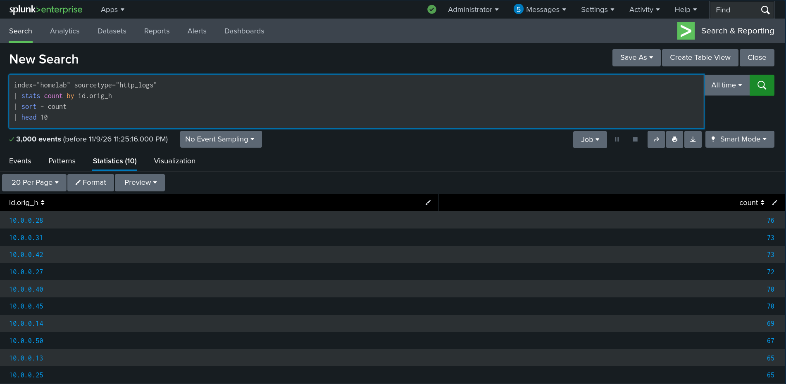
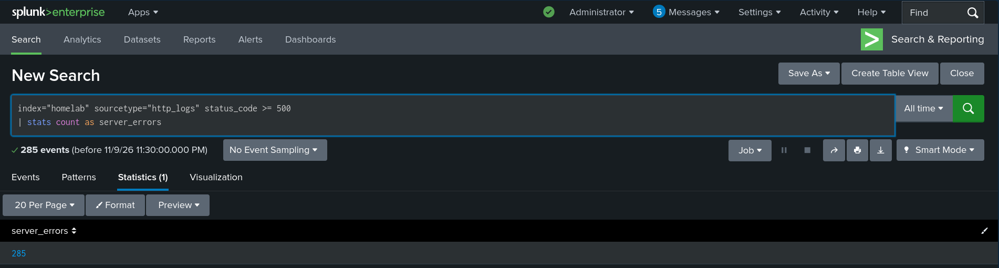
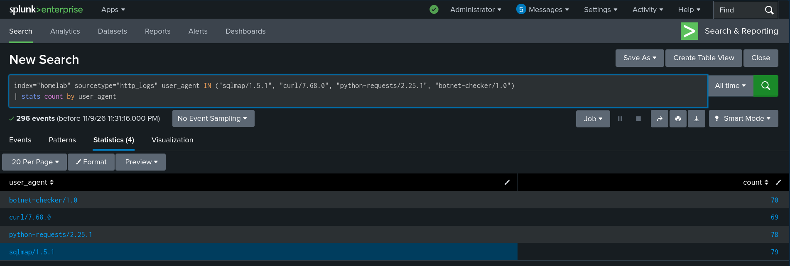
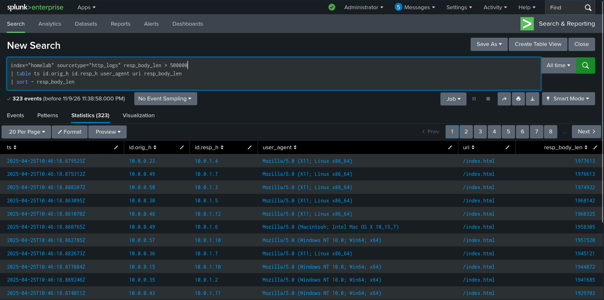
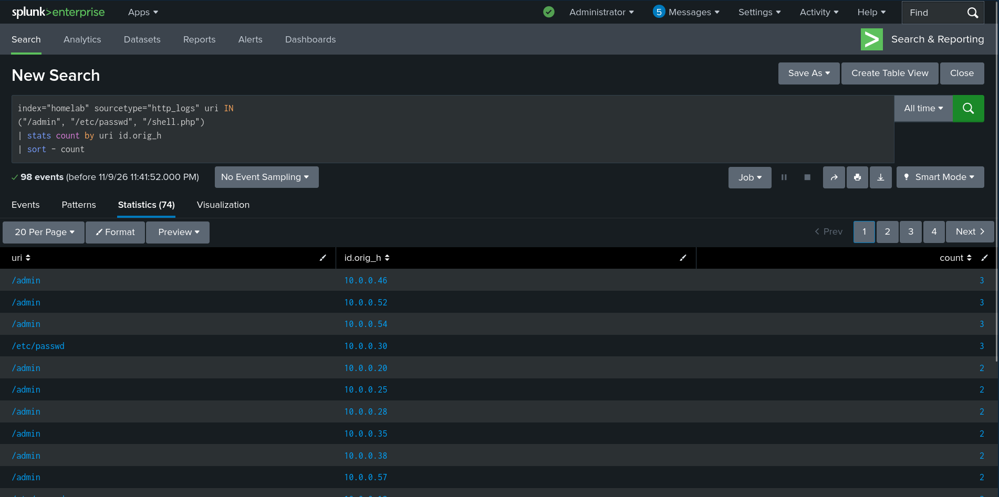

# HTTP Log Analysis with Splunk

## 1. Investigation Overview

This investigation analyzes HTTP web-traffic logs ingested into Splunk Enterprise. Web logs are one of the richest data sources a SOC has: every scan, exploit attempt, credential-stuffing run, and data-exfiltration transfer leaves traces in URIs, user agents, status codes, and response sizes.

The investigation covers five questions: who generates the most web traffic, how many server errors (5xx) occurred, which scripted or suspicious user agents are present, whether unusually large transfers are happening, and whether sensitive URIs such as `/admin`, `/shell.php`, or `/etc/passwd` are being probed. Together these form a realistic first-pass web-attack triage workflow.

## 2. Log Source and Data

| Property | Value |
|---|---|
| Index | `homelab` |
| Sourcetype | `http_logs` |
| Log format | JSON |
| Event volume | 3,000 events in the analyzed timeframe |

**Key fields:**

| Field | Meaning |
|---|---|
| `ts` | Event timestamp |
| `id.orig_h` | Source IP (the client making the request) |
| `id.resp_h` | Destination host (the web server) |
| `uri` | Requested path (e.g., `/index.html`, `/admin`) |
| `user_agent` | Client user-agent string |
| `status_code` | HTTP response status code |
| `resp_body_len` | Size of the response body in bytes |

## 3. Investigation Tasks

### Task 1: Find the top 10 source IPs generating web traffic

**Objective:** Rank the noisiest clients in the HTTP dataset to establish a traffic baseline and identify hosts worth watching.

**SPL Query:**

```spl
index="homelab" sourcetype="http_logs"
| stats count by "id.orig_h"
| sort -count
| head 10
```

**Query Explanation:**

| Command | Purpose |
|---|---|
| `index="homelab" sourcetype="http_logs"` | Selects the HTTP dataset. |
| `stats count by "id.orig_h"` | Counts HTTP events per source IP. |
| `sort -count` | Descending order — busiest clients first. |
| `head 10` | Keeps only the first 10 rows of the ranked result. |

**Analysis:**

The search processed **3,000 events**. The top 10 source IPs:

| id.orig_h | count |
|---|---|
| 10.0.0.28 | 76 |
| 10.0.0.31 | 73 |
| 10.0.0.42 | 73 |
| 10.0.0.27 | 72 |
| 10.0.0.40 | 70 |
| 10.0.0.45 | 70 |
| 10.0.0.14 | 69 |
| 10.0.0.50 | 67 |
| 10.0.0.13 | 65 |
| 10.0.0.25 | 65 |

Volume is evenly spread (65–76 events per host), consistent with the simulated lab dataset. Nothing stands out, which is itself a baseline result: in production data this view would immediately flag a host abnormally dominating web traffic.

> **Scoping note:** the original task was titled "top 10 *endpoints* generating web traffic", but the executed search aggregates by **source IP** (`id.orig_h`), not by requested URI. Both are legitimate questions; the endpoint-oriented variant (`stats count by uri`) is documented in the optional-improvements section of [`queries/http-queries.spl`](../queries/http-queries.spl) but was not run and has no screenshot evidence.

**SOC Analyst Perspective:**

Traffic-volume ranking is the triage view for web attacks: scanners and brute-force tools are, by nature, the loudest clients. Next steps in a real investigation: pivot the top talkers into the suspicious-URI and user-agent searches below, and compare today's ranking against the daily baseline to catch a client whose volume suddenly spiked.

**Evidence:**



---

### Task 2: Count the number of server errors (5xx) observed

**Objective:** Quantify server-side errors in the web traffic — a health signal for the application and, in attack scenarios, a side effect of malformed exploit requests.

**SPL Query:**

```spl
index="homelab" sourcetype="http_logs" status_code>=500 status_code<600
| stats count as server_errors
```

**Query Explanation:**

| Command | Purpose |
|---|---|
| `status_code>=500 status_code<600` | Numeric field filters — matches all 5xx server-error classes (500–599). |
| `stats count as server_errors` | Aggregates the filtered set into a single named count. |

**Analysis:**

The search returned **285 events matching `server_errors = 285`** — roughly 9.5% of the 3,000-event dataset. The screenshot captured the executed search using only `status_code>=500`; the `<600` upper bound in the query above is redundant (status codes above 599 do not occur in this dataset) but makes the 5xx range explicit.

For a SOC analyst, a high 5xx rate can mean: an application failing under load, an exploit in progress (many attacks produce server errors as malformed payloads break the application), or an application-layer DoS. Distinguishing these requires looking at *which URIs* return 5xx and *which clients* generate them.

**SOC Analyst Perspective:**

5xx volume alone is not an attack indicator — it is an anomaly trigger. The follow-up is always `stats count by uri, status_code, id.orig_h`: a single client hammering one URI into 500-errors looks like probing; 500-errors spread across clients on one URI looks like an application bug; 500-errors from one client across many URIs looks like scanning with malformed requests.

**Evidence:**



---

### Task 3: Identify User-Agents associated with possible scripted attacks

**Objective:** Surface requests made by known scripted or offensive tooling user agents, which stand out sharply against browser traffic.

**SPL Query:**

```spl
index="homelab" sourcetype="http_logs" user_agent IN ("sqlmap/1.5.1", "curl/7.68.0", "python-requests/2.25.1", "botnet-checker/1.0")
| stats count by user_agent
```

**Query Explanation:**

| Command | Purpose |
|---|---|
| `user_agent IN (...)` | The `IN` operator matches the field against a value list — cleaner than chained `OR` conditions. |
| `stats count by user_agent` | Counts requests per flagged user agent. |

**Analysis:**

The search returned **296 events** across the four flagged user agents:

| user_agent | count |
|---|---|
| sqlmap/1.5.1 | 79 |
| python-requests/2.25.1 | 78 |
| botnet-checker/1.0 | 70 |
| curl/7.68.0 | 69 |

All four are tooling signatures rather than browsers: **sqlmap** is a dedicated SQL-injection tool, **python-requests** and **curl** are scripted HTTP clients, and **botnet-checker** is a non-standard string not produced by any legitimate browser. Their presence means scripted (non-human) clients are actively interacting with the server.

> **Accuracy note:** detecting a scripted user agent is *not* evidence of a successful or even attempted exploit. Legitimate automation (monitoring, CI scripts) also uses curl and python-requests; sqlmap and botnet-checker, however, have no routine legitimate use on a production web tier and warrant priority review.

**SOC Analyst Perspective:**

User-agent triage is high-signal, low-cost detection. Analysts should: baseline which scripted agents are *expected* in the environment (and whitelist those), investigate what URIs the unexpected agents touched, and correlate sqlmap/botnet-checker traffic with any 5xx errors from Task 2 — SQL-injection tooling commonly generates server errors while probing.

**Evidence:**



---

### Task 4: Find large file transfers (greater than 500 KB)

**Objective:** Identify unusually large HTTP responses — potential data staging or exfiltration that hides inside normal-looking web traffic.

**SPL Query:**

```spl
index="homelab" sourcetype="http_logs" resp_body_len>500000
| table ts "id.orig_h" "id.resp_h" user_agent uri resp_body_len
| sort -resp_body_len
```

**Query Explanation:**

| Command | Purpose |
|---|---|
| `resp_body_len>500000` | Numeric filter — responses exceeding 500 KB (~512,000 bytes). |
| `table ...` | Projects the relevant fields into a flat table for review. |
| `sort -resp_body_len` | Largest transfers first. |

**Analysis:**

The search returned **323 events** — over 10% of the dataset transferred more than 500 KB. The largest responses were ~1.9–2.0 MB, all serving `/index.html` from a `10.0.1.x` server to various `10.0.0.x` clients, with browser user agents (Mozilla/5.0 variants):

| ts | id.orig_h | id.resp_h | uri | resp_body_len |
|---|---|---|---|---|
| 2025-04-25T10:46:18.879523Z | 10.0.0.23 | 10.0.1.4 | /index.html | 1,977,013 |
| 2025-04-25T10:46:18.875312Z | 10.0.0.49 | 10.0.1.7 | /index.html | 1,976,613 |
| 2025-04-25T10:46:18.888207Z | 10.0.0.50 | 10.0.1.3 | /index.html | 1,974,922 |

At ~2 MB each, these are far beyond typical page sizes. In this dataset the transfers are uniform across clients and URIs (all `/index.html`), which points to oversized content generation rather than targeted exfiltration — but in production, this same search is a primary exfiltration detector.

**SOC Analyst Perspective:**

Large outbound responses are how data theft looks in HTTP logs: an attacker dumping a database or archiving a fileshare produces responses far larger than normal pages. Analysts should compare transfer sizes against the per-URI baseline, check *who* received the largest transfers, and look for a single client accumulating many large responses over time (piecemeal exfiltration).

**Evidence:**



---

### Task 5: Detect suspicious URIs accessed (e.g., /admin, /shell.php, /etc/passwd)

**Objective:** Detect requests to sensitive or malicious paths — administrative interfaces, webshells, and path-traversal attempts against system files.

**SPL Query:**

```spl
index="homelab" sourcetype="http_logs" uri IN ("/admin","/shell.php","/etc/passwd")
| stats count by uri, "id.orig_h"
```

**Query Explanation:**

| Command | Purpose |
|---|---|
| `uri IN (...)` | Matches requests to the three sensitive paths. |
| `stats count by uri, "id.orig_h"` | Counts hits per URI **and** source IP — attributing reconnaissance to specific clients. |

**Analysis:**

The search returned **98 events across 74 unique URI/source combinations**. The most active pairs:

| uri | id.orig_h | count |
|---|---|---|
| /admin | 10.0.0.46 | 3 |
| /admin | 10.0.0.52 | 3 |
| /admin | 10.0.0.54 | 3 |
| /etc/passwd | 10.0.0.30 | 3 |
| /admin | 10.0.0.20 | 2 |
| /admin | 10.0.0.25 | 2 |
| ... | ... | ... |

Three behaviors are visible: repeated **`/admin`** access attempts (probing for an exposed admin interface, a classic brute-force/credential-stuffing entry point), a **`/etc/passwd`** request (path-traversal or local-file-inclusion probing — this file should never be served over HTTP), and **`/shell.php`** lookups (probing for a planted webshell or testing whether a previously uploaded shell persists). The attribution per source IP directly feeds the "which client do I investigate first" decision.

**SOC Analyst Perspective:**

Sensitive-path probing is reconnaissance for a follow-on attack, and its severity depends on the server's response: an analyst should immediately check the `status_code` of these requests — a **200** on `/etc/passwd` or `/shell.php` means the file was actually served or the shell exists, which escalates from "reconnaissance" to "confirmed compromise indicator"; 403/404 responses mean the probe failed but the intent was real. Correlate the listed source IPs with the user-agent results from Task 3 to confirm automated tooling.

**Evidence:**



---

## 4. SPL Commands and Techniques Used in This Investigation

| Command / Technique | Role here |
|---|---|
| `stats` / `count` / `by` | Aggregation and grouping — per source IP, URI, user agent, or URI+source pair. |
| `sort` / `head` | Ranking and trimming — descending order, keep top N. |
| `table` | Projects selected fields into a readable result table. |
| `IN (...)` | Compact multi-value matching against a field (user agents, URIs). |
| Numeric field filters | Direct comparisons on extracted fields (`status_code>=500`, `resp_body_len>500000`). |
| `as` | Renames aggregated fields (`count as server_errors`) for readable output. |

## 5. Why These Patterns Matter to a SOC Analyst

Each search in this investigation maps to a stage of a typical web-attack lifecycle: **volume profiling** (Task 1) finds the loud actors; **5xx analysis** (Task 2) catches exploit payloads breaking the application; **user-agent triage** (Task 3) separates humans from tooling; **large-transfer detection** (Task 4) exposes data leaving the environment; and **sensitive-URI detection** (Task 5) catches the reconnaissance that precedes exploitation. Run together against the same dataset, they let an analyst connect "a scripted client (Task 3) that probed `/admin` (Task 5)" into a coherent narrative instead of isolated curiosities.

## 6. Evidence Summary

| Task | Screenshot | Verified |
|---|---|---|
| 1 | [`http-top-source-ips.png`](../screenshots/http/http-top-source-ips.png) | Yes |
| 2 | [`http-server-errors.png`](../screenshots/http/http-server-errors.png) | Yes |
| 3 | [`http-suspicious-user-agents.png`](../screenshots/http/http-suspicious-user-agents.png) | Yes |
| 4 | [`http-large-file-transfers.png`](../screenshots/http/http-large-file-transfers.png) | Yes |
| 5 | [`http-suspicious-uris.png`](../screenshots/http/http-suspicious-uris.png) | Yes |

Screenshots were captured from Splunk Enterprise Search & Reporting on 2026-11-09.

---

Return to the [main README](../README.md).
