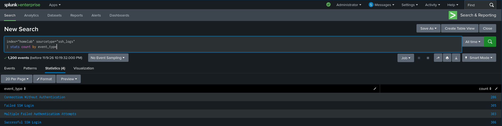
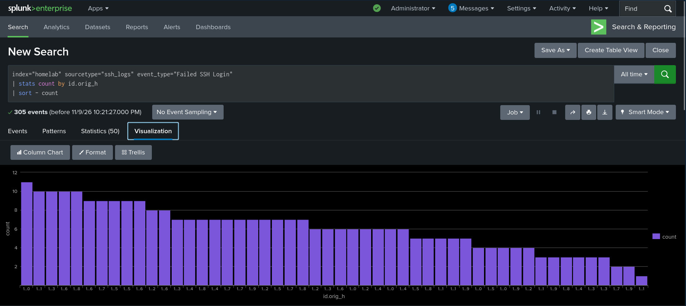
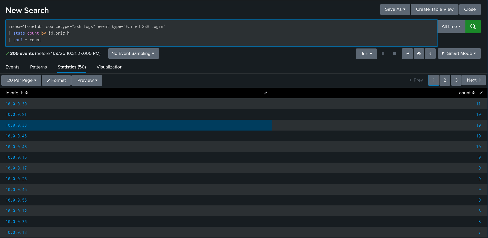
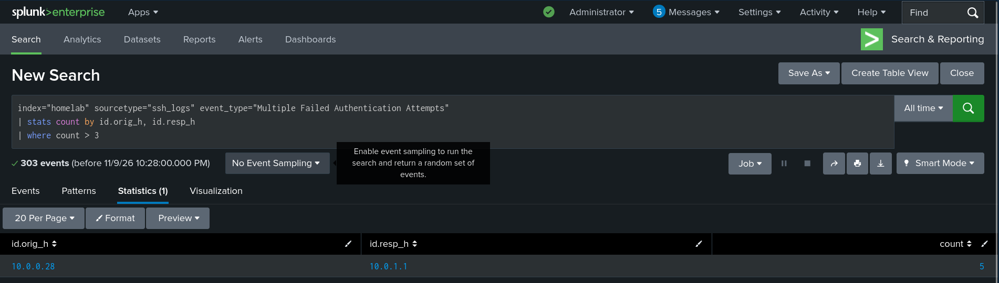
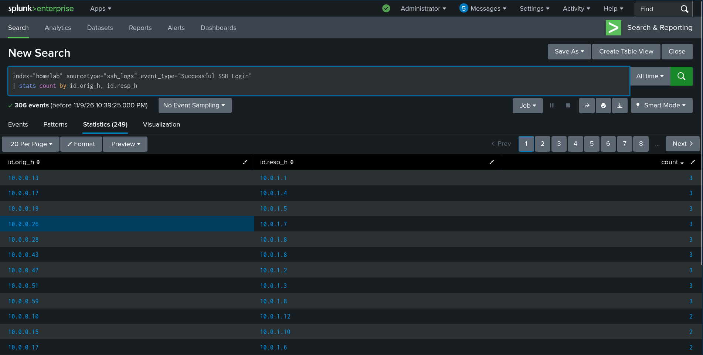
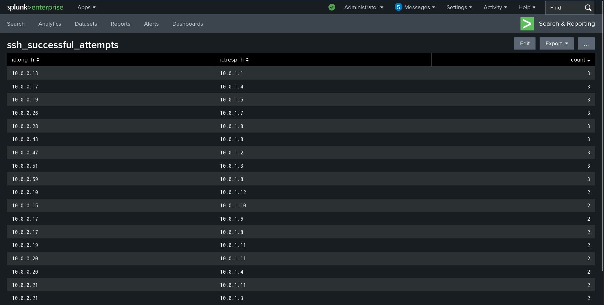
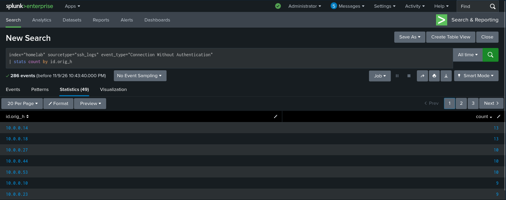
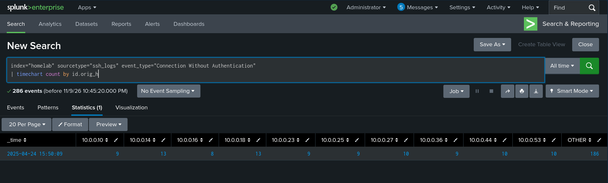

# SSH Log Analysis with Splunk

## 1. Investigation Overview

This investigation focuses on SSH authentication activity ingested into Splunk Enterprise. SSH is the primary remote-administration protocol on Linux infrastructure and one of the most targeted services on any network — brute-force password guessing against SSH is a constant background noise on internet-facing systems and a common lateral-movement technique after initial compromise.

The investigation walks through the full analysis lifecycle: validating log ingestion and field extraction, profiling failed logins, detecting repeated authentication failures (brute-force behavior), tracking successful logins to spot potential compromised accounts, hunting for connections that never authenticated at all, and finally visualizing the activity over time. A threshold-based alert design (>5 login attempts within 10 minutes) was documented as part of this task.

## 2. Log Source and Data

| Property | Value |
|---|---|
| Index | `homelab` |
| Sourcetype | `ssh_logs` |
| Log format | JSON (`ssh_log.json` uploaded to Splunk) |
| Event volume | 1,200 events in the analyzed timeframe |

**Key fields validated at ingestion:**

| Field | Meaning |
|---|---|
| `event_type` | One of: `Successful SSH Login`, `Failed SSH Login`, `Multiple Failed Authentication Attempts`, `Connection Without Authentication` |
| `auth_success` | Authentication outcome: `true` / `false` / null |
| `auth_attempts` | Number of authentication attempts in the event |
| `id.orig_h` | Source IP (the client attempting connection) |
| `id.resp_h` | Destination host (the SSH server) |

> **Index-name correction (documented, not silent):** the original notes referred to the validation search as `index=ssh_log`, but every screenshot captured during the work shows the searches actually ran against `index="homelab" sourcetype="ssh_logs"`. The event counts in the screenshots (1,200 SSH events, 305 failed, 303 multiple-failed, 306 successful, 286 no-auth) confirm which configuration was live. All queries in this document use the verified form. The original notes have been corrected to match.

## 3. Investigation Tasks

### Task 1: Ingest and Parse Logs

**Objective:** Confirm the SSH log file was ingested correctly and that the four expected `event_type` values were extracted as searchable fields.

**SPL Query:**

```spl
index="homelab" sourcetype="ssh_logs" | stats count by event_type
```

**Query Explanation:**

| Command | Purpose |
|---|---|
| `index="homelab" sourcetype="ssh_logs"` | Selects the ingested SSH dataset. |
| `stats count by event_type` | Groups events by their classified type and counts each — an ingestion sanity check. |

**Analysis:**

The validation search returned **1,200 events** evenly split across the four event types:

| event_type | count |
|---|---|
| Connection Without Authentication | 286 |
| Failed SSH Login | 305 |
| Multiple Failed Authentication Attempts | 303 |
| Successful SSH Login | 306 |

All four expected classifications are present in roughly equal proportion, confirming that field extraction for `event_type` worked and the dataset is balanced (consistent with a synthetic lab dataset).

**SOC Analyst Perspective:**

The first thing an analyst does with any new data source is prove it is complete and correctly parsed. If `event_type` had come through as one blob or with unexpected values, every downstream detection built on it would silently fail. This validation step is also where the analyst inventories the fields available for detection engineering (`auth_success`, `auth_attempts`, `id.orig_h`, `id.resp_h`).

**Evidence:**



---

### Task 2: Analyze Failed Login Attempts

**Objective:** Profile failed SSH logins per source IP, identify the top offending hosts, and present the result as a bar-chart visualization.

**SPL Query:**

```spl
index="homelab" sourcetype="ssh_logs" event_type="Failed SSH Login"
| stats count by id.orig_h
| sort - count
```

**Query Explanation:**

| Command | Purpose |
|---|---|
| `event_type="Failed SSH Login"` | Filters to failed authentication events only. |
| `stats count by id.orig_h` | Counts failed logins per source IP. |
| `sort - count` | Ranks the noisiest sources first (the "top 10" view is obtained by reading the first rows of this table). |

**Analysis:**

The search returned **305 failed-login events across 50 source IPs**. The top sources were:

| id.orig_h | count |
|---|---|
| 10.0.0.30 | 11 |
| 10.0.0.21 | 10 |
| 10.0.0.33 | 10 |
| 10.0.0.46 | 10 |
| 10.0.0.48 | 10 |
| 10.0.0.16 | 9 |
| 10.0.0.17 | 9 |
| 10.0.0.25 | 9 |
| 10.0.0.45 | 9 |
| 10.0.0.56 | 9 |

The distribution is fairly flat (7–11 attempts per host). No single IP towers over the rest in this dataset, which matches the simulated-traffic pattern; in real internet-facing data, a small set of IPs dominating failed logins is the classic signature of dictionary-attack tooling.

**Visualization:** the same search was rendered as a column chart to make outliers visually obvious.



**SOC Analyst Perspective:**

Failed-login volume per source is the fundamental SSH detection primitive. Next investigative steps: check *which usernames* each source attempted (a real brute-force tool tries many usernames; a mistyped cron job tries exactly one), check whether any of these sources later *succeeded* (pivots directly into Task 4), and geo-ASN-check sources if the environment is internet-facing.

**Evidence:**



---

### Task 3: Detect Multiple Failed Authentication Attempts (Brute Force)

**Objective:** Detect hosts generating repeated authentication failures — the behavioral signature of brute-force password guessing — by counting failures per source/destination pair and filtering above a threshold.

**SPL Query:**

```spl
index="homelab" sourcetype="ssh_logs" event_type="Multiple Failed Authentication Attempts"
| stats count by id.orig_h, id.resp_h
| where count > 3
```

**Query Explanation:**

| Command | Purpose |
|---|---|
| `event_type="Multiple Failed Authentication Attempts"` | Selects events already classified as containing multiple failed attempts. |
| `stats count by id.orig_h, id.resp_h` | Counts occurrences per attacker-target pair — who is hammering which server. |
| `where count > 3` | Keeps only pairs exceeding the investigative threshold, suppressing isolated noise. |

**Analysis:**

Of **303 multiple-failure events**, only one source/destination pair exceeded the filter:

| id.orig_h | id.resp_h | count |
|---|---|---|
| 10.0.0.28 | 10.0.0.1 | 5 |

Source `10.0.0.28` repeatedly attacked host `10.0.0.1` — a concentrated, repeated pattern against a single target rather than broad scanning. This is the pair an analyst would pull credentials-attempted and timeline data for first.

**Alert configuration:** the investigation documented a threshold-based alert design — *trigger when any source IP exceeds 5 login attempts within 10 minutes*. This matches the detection logic above; the alert's configuration screen was not captured in a screenshot, so the saved alert itself remains to be verified in the Splunk instance.

**SOC Analyst Perspective:**

Repeated failures against one target is the strongest cheap indicator of SSH brute force. An analyst should next determine: did any attempt eventually succeed (`auth_success` flip to true for this pair)? Which accounts were targeted — one account hammered (targeted attack) or many accounts tried (credential stuffing)? If a success followed the failures, treat the account as potentially compromised and check what that account did post-login.

**Evidence:**



---

### Task 4: Track Successful Logins

**Objective:** Profile successful SSH logins per source/destination pair and correlate them with prior failures — the standard technique for surfacing compromised accounts.

**SPL Query:**

```spl
index="homelab" sourcetype="ssh_logs" event_type="Successful SSH Login"
| stats count by id.orig_h, id.resp_h
```

**Query Explanation:**

| Command | Purpose |
|---|---|
| `event_type="Successful SSH Login"` | Filters to successful authentications. |
| `stats count by id.orig_h, id.resp_h` | Counts successful logins per client-server pair. |

**Analysis:**

The search returned **306 successful-login events across 249 unique source/destination pairs** — at most 3 logins per pair in the analyzed window. No pair shows an excessive number of successes.

The investigative value is in the *comparison*: cross-referencing this table with the Task 2/Task 3 results identifies sources that both failed repeatedly **and** eventually logged in — the pattern of a successful brute-force attack. In this dataset, the high-volume failure sources (Task 2) and the >3-failure pair (Task 3) should be checked against this table; a matching pair would be a confirmed compromise candidate.

**SOC Analyst Perspective:**

"Success after failures" is one of the highest-signal detections available from authentication logs — it means someone kept guessing until they got in. Analysts should also baseline *who normally logs into what*; a successful login from a host or to an account with no history is immediately suspicious even without prior failures.

**Evidence:**



### Dashboard: Successful Login Panel

The Task 4 search was saved as a dashboard table panel named **`ssh_successful_attempts`**, showing the per-pair login counts:



---

### Task 5: Spot Suspicious Connections Without Authentication

**Objective:** Hunt for SSH connections that opened but never attempted authentication — behavior typical of port scanners and SSH-version probing.

**SPL Query:**

```spl
index="homelab" sourcetype="ssh_logs" event_type="Connection Without Authentication"
| stats count by id.orig_h
```

**Query Explanation:**

| Command | Purpose |
|---|---|
| `event_type="Connection Without Authentication"` | Filters to connections that closed without any authentication attempt. |
| `stats count by id.orig_h` | Counts such connections per source IP. |

**Analysis:**

The search returned **286 events across 49 source IPs**. The most active sources:

| id.orig_h | count |
|---|---|
| 10.0.0.14 | 13 |
| 10.0.0.18 | 13 |
| 10.0.0.27 | 10 |
| 10.0.0.44 | 10 |
| 10.0.0.53 | 10 |
| 10.0.0.10 | 9 |

**Timechart analysis** — the same events were then plotted over time to see whether unauthenticated probing is constant or bursty:

```spl
index="homelab" sourcetype="ssh_logs" event_type="Connection Without Authentication"
| timechart count by id.orig_h
```

The timechart search returned the same **286 events**, with the data concentrated at timestamp `2025-04-24 15:50:09` in the analyzed window. *Note: the screenshot captured shows the timechart's Statistics table rather than the rendered chart visualization.*

**SOC Analyst Perspective:**

A connection that never authenticates is reconnaissance, not access — but it is reconnaissance with intent. Repeated no-auth connections from one source usually mean an SSH banner grab (tooling fingerprinting the server version for known exploits) or a port scan. Bursty patterns over time suggest active scanning campaigns; a *new* source suddenly appearing in this list deserves an immediate look, especially against the "new source + later failed logins" combination.

**Evidence:**





---

## 4. SPL Commands Used in This Investigation

| Command | Role here |
|---|---|
| `stats` | Aggregates events into per-group counts (by `event_type`, `id.orig_h`, or source/destination pairs). |
| `count` | The computed statistic — number of events per group. |
| `by` | Defines the grouping key(s); pairing `id.orig_h, id.resp_h` links attacker to target. |
| `timechart` | Like `stats`, but buckets results into time slots, enabling trend/periodicity analysis. |
| `where` | Post-aggregation filter (`count > 3`) used to enforce the detection threshold. |

## 5. Brute-Force Detection: Why It Works

Every SSH password guess produces a failed-login event. A human mistyping a password produces one or two failures; automated password-guessing tools produce hundreds in minutes. That rate difference is what the detection exploits: count failures per source within a fixed window, and flag sources whose rate no human would produce. The documented alert threshold for this environment — **more than 5 login attempts within 10 minutes** — is a starting point that should be tuned against observed baselines to balance missed attacks against alert fatigue.

Successful logins that *follow* repeated failures from the same source are the confirmation signal: it means the guessing eventually worked. Such accounts must be treated as compromised until proven otherwise — disable, investigate post-auth activity (commands run, data touched, lateral connections), and rotate credentials.

> **Accuracy note:** the data in this investigation shows the detection *pattern* (a source exceeding the failure threshold, i.e., 10.0.0.28 → 10.0.0.1 with 5 attempts). Nothing in the captured evidence proves that a successful brute-force attack occurred — no failure-then-success correlation for that pair was captured in the screenshots. This is documented as a lead, not an incident.

## 6. Evidence Summary

| Task | Screenshot(s) | Verified |
|---|---|---|
| 1 | [`ssh-event-type-validation.png`](../screenshots/ssh/ssh-event-type-validation.png) | Yes |
| 2 | [`ssh-failed-logins.png`](../screenshots/ssh/ssh-failed-logins.png), [`ssh-failed-logins-chart.png`](../screenshots/ssh/ssh-failed-logins-chart.png) | Yes |
| 3 | [`ssh-multiple-failed-attempts.png`](../screenshots/ssh/ssh-multiple-failed-attempts.png) — alert configuration screenshot not captured | Partial |
| 4 | [`ssh-successful-logins.png`](../screenshots/ssh/ssh-successful-logins.png) | Yes |
| Dashboard | [`ssh-dashboard.png`](../screenshots/ssh/ssh-dashboard.png) | Yes |
| 5 | [`ssh-unauthenticated-connections.png`](../screenshots/ssh/ssh-unauthenticated-connections.png), [`ssh-unauthenticated-timechart.png`](../screenshots/ssh/ssh-unauthenticated-timechart.png) | Yes (timechart shows Statistics table, not rendered chart) |

Screenshots were captured from Splunk Enterprise Search & Reporting on 2026-11-09.

---

Return to the [main README](../README.md).
